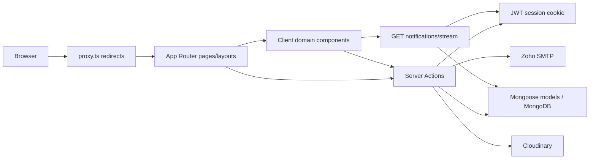
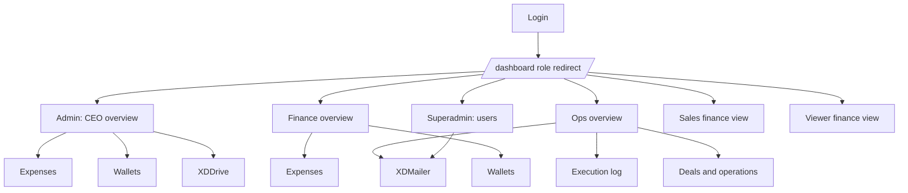
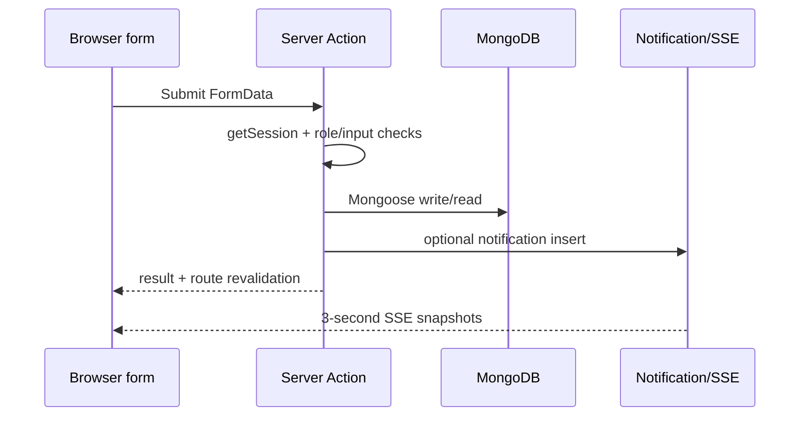

# AHS-XD project analysis

Source-only audit, 29 October 2026. This document records the codebase **before** the Investor Relations implementation added later in the same session. For the new investor model, shared Operations/CEO directory, profile route, permissions and refresh behavior, see `docs/INVESTOR_RELATIONS.md`. Counts below are the pre-implementation audit counts. No application, database, SMTP server, Cloudinary account, or deployment was exercised during this audit. **Unverified** means source alone cannot establish the runtime outcome. Counts treat a `page.tsx` as one page even when it renders several query-string views.

## 1. Executive Project Overview

AHS-XD is an internal executive dashboard for users, finance, operations, file storage, bulk mail, and notifications. The root route redirects users to login or their role home. Six roles have home dashboards: superadmin, admin/CEO, finance, operations, sales, and viewer. Two further dashboard routes host XDDrive and XDMailer. There are **15 page files, 1 explicitly implemented HTTP API endpoint, 6 role home dashboards, 2 feature routes, and 12 Mongoose models**. Thus the source defines **16 application routes** when the API endpoint is included. The URL query string adds views within pages; it does not create additional Next.js route files. Evidence: `app/page.tsx`, `app/(dashboard)/dashboard/**/page.tsx`, `lib/roles.ts`, `models/`.

## 2. Confirmed Technology Stack

`package.json` specifies Next.js **16.2.2**, React/React DOM **19.2.4**, TypeScript 5, Tailwind CSS 4, Mongoose 9, jose 6, bcryptjs 3, Nodemailer 8, Cloudinary 2, TipTap 3, Radix UI, shadcn component conventions, Recharts 3, Sonner, lucide-react, next-themes, PapaParse, and xlsx. pnpm is evidenced by `pnpm-lock.yaml` and `pnpm-workspace.yaml`; no `packageManager` or Node engine is declared. Next's installed `node_modules/next/dist/docs/01-app/03-api-reference/03-file-conventions/{proxy,route,route-groups}.md` confirms that route groups do not affect URLs, `proxy.ts` replaces middleware, and `route.ts` supplies HTTP handlers. A listed dependency is not proof that it is used in a rendered feature.

## 3. Repository Structure and Directory Tree

```text
.
├── app/
│   ├── layout.tsx, page.tsx, globals.css, favicon.ico
│   ├── (auth)/layout.tsx
│   │   ├── login/page.tsx, verify/page.tsx, set-password/page.tsx
│   │   └── forgot-password/page.tsx, forgot-password/verify/page.tsx
│   ├── (dashboard)/layout.tsx
│   │   └── dashboard/page.tsx
│   │       ├── superadmin/page.tsx, ceo/page.tsx, finance/page.tsx
│   │       ├── ops/page.tsx, sales/page.tsx, viewer/page.tsx
│   │       └── xddrive/page.tsx, xdmails/page.tsx
│   └── api/notifications/stream/route.ts
├── actions/ auth, users, finance, operations, execution, drive,
│            emails, media, notifications (.ts)
├── models/ User, Wallet, Transaction, Transfer, FinanceConfig,
│           Operation, ExecutionLog, Notification, DriveFolder,
│           DriveDocument, EmailCampaign, Media (.ts)
├── components/
│   ├── dashboard/, finance/, ops/, ceo/, drive/, emails/, notifications/
│   └── ui/ (Radix/shadcn style primitives)
├── lib/ db.ts, session.ts, roles.ts, otp.ts, mailer.ts, utils.ts
├── providers/theme_provider.tsx; hooks/use-mobile.ts
├── public/ logos, favicons, fonts, notification audio
├── docs/ XDMailer and media notes; scripts/seed.ts
├── proxy.ts; next.config.ts; tsconfig.json; eslint.config.mjs
├── postcss.config.mjs; components.json; package.json
└── pnpm-lock.yaml; pnpm-workspace.yaml; README.md
```

`app/` defines routes and server-rendered page composition. `actions/` exposes server functions imported by client forms and server pages. `models/` defines MongoDB documents; `lib/db.ts` supplies the shared connection. Domain component folders render dashboard sections. `components/ui/` supplies primitives. `proxy.ts` handles early redirects. `docs/` contains feature notes, while root `README.md` remains a starter template. No `src/`, Pages Router, dynamic segments, parallel routes, intercepting routes, route-specific `loading.tsx`, `error.tsx`, or `not-found.tsx` were found in `app/`.

## 4. System Architecture



The root layout supplies fonts, theme and tooltip providers. Auth and dashboard route-group layouts provide separate shells. The dashboard layout verifies a signed session and mounts the sidebar and refresh listener (`app/layout.tsx`, `app/(auth)/layout.tsx`, `app/(dashboard)/layout.tsx`). No conventional JSON CRUD API layer exists; browser mutations call exported Server Actions directly.

## 5. Public Pages and Route Inventory

All paths below are actual URL paths. Auth pages share `app/(auth)/layout.tsx`; dashboard pages share `app/(dashboard)/layout.tsx` and `components/dashboard/shell.tsx`. The proxy excludes `/api` and static assets. The shell supplies navigation, notification bell, theme switcher, greeting, and logout.

| Route | Source | Purpose, data/action, access |
|---|---|---|
| `/` | `app/page.tsx` | Null page; `proxy.ts` redirects to `/login` or role home using cookies. |
| `/login` | `app/(auth)/login/page.tsx` | Email/password form calls `loginAction`; redirects to `/verify`; signed-in users redirected by proxy. |
| `/verify` | `app/(auth)/verify/page.tsx` | Four-digit login OTP, resend; `verifyOtpAction`, `resendOtpAction`, `User`; pending-email cookie required by actions. |
| `/forgot-password` | `app/(auth)/forgot-password/page.tsx` | Requests reset OTP via `forgotPasswordAction`; public. |
| `/forgot-password/verify` | `app/(auth)/forgot-password/verify/page.tsx` | Reset OTP and resend via `forgotVerifyOtpAction`, `resendForgotOtpAction`; forgot-email cookie required. |
| `/set-password` | `app/(auth)/set-password/page.tsx` | First-login/reset password form via `setPasswordAction`; set-password UID cookie required. |
| `/dashboard` | `app/(dashboard)/dashboard/page.tsx` | Signed-session redirect to `getRoleHome` (`lib/roles.ts`). |
| `/dashboard/superadmin` | `app/(dashboard)/dashboard/superadmin/page.tsx` | User counts/list and management; `getUsers`, `getUserStats`, `User`; superadmin page guard. |
| `/dashboard/ceo` | `app/(dashboard)/dashboard/ceo/page.tsx` | Finance/ops executive view; `?view=finance\|ops`, `?tab=expenses\|wallets\|xddrive`; Finance, Operation, Execution, Drive models; superadmin/admin. |
| `/dashboard/finance` | `app/(dashboard)/dashboard/finance/page.tsx` | Finance overview, `?tab=expenses\|wallets`; `getFinanceData`; Transaction, Wallet, FinanceConfig; superadmin/admin/finance/sales. |
| `/dashboard/ops` | `app/(dashboard)/dashboard/ops/page.tsx` | Ops KPIs/charts, `?tab=execution\|deals`; `getExecutionStats`, `getOpsStats`, `getFinanceData`, conditional list actions; superadmin/admin/ops/**sales per page**, though proxy role map excludes sales. |
| `/dashboard/sales` | `app/(dashboard)/dashboard/sales/page.tsx` | Read-only finance views with `?tab=expenses\|wallets`; `getFinanceData`; superadmin/admin/sales. |
| `/dashboard/viewer` | `app/(dashboard)/dashboard/viewer/page.tsx` | Read-only finance views with `?tab=expenses\|wallets`; any signed session by page guard. |
| `/dashboard/xddrive` | `app/(dashboard)/dashboard/xddrive/page.tsx` | `DriveExplorer` client component; data via `actions/drive.ts`; only dashboard layout guard on page; action guard limits operations to superadmin/admin/finance. |
| `/dashboard/xdmails` | `app/(dashboard)/dashboard/xdmails/page.tsx` | `?view=compose\|campaigns`; TipTap editor, campaign list, media; `actions/emails.ts`, `actions/media.ts`; superadmin/admin/ops. |
| `/api/notifications/stream` | `app/api/notifications/stream/route.ts` | GET SSE endpoint; see section 10. |

There are no explicit custom error, not-found or loading route files. Static files in `public/` are served by the framework but are not counted as application pages or API endpoints.

## 6. Complete Dashboard Architecture

All six role dashboards use the same signed-session layout, sidebar and top bar (`app/(dashboard)/layout.tsx`, `components/dashboard/shell.tsx`). `lib/roles.ts` maps role homes and optimistic proxy allowances; each page usually performs another role check. Dashboard view changes use links/query parameters rather than nested route files. `components/notifications/notification-bell.tsx` and `components/dashboard/realtime-refresh.tsx` each open an EventSource. The latter refreshes server components when unread count changes.



**Superadmin:** landing view manages users; navigation also exposes CEO, finance, Drive, operations, mail and sales. **Admin/CEO:** executive overview toggles finance and ops, plus expenses, wallets, Drive and mail. **Finance:** finance overview/expenses/wallets and Drive. **Operations:** KPI overview, execution, deals and XDMailer. **Sales:** finance overview/expenses/wallets; ops page code allows sales but proxy navigation/allow map does not. **Viewer:** read-only finance views. These are six dashboard homes, not six isolated applications; financial modules are shared. XDDrive and XDMailer are feature routes within the dashboard shell, not additional role homes.

## 7. Detailed Dashboard Module Inventory

Each row is a distinct major view or feature module; **18 modules** are listed. `R` = read; `C` = create; `U` = update; `D` = delete. Controls described as UI and action restrictions are differentiated below.

| Dashboard | Module | Route/view | Main features | Data source | Access control |
|---|---|---|---|---|---|
| Superadmin | User metrics | `/dashboard/superadmin` | R total, active, suspended, pending and role counts | `getUserStats` → User | Superadmin action/page |
| Superadmin | User management | `/dashboard/superadmin` | R/C/U, suspend/reactivate, soft D users | `getUsers`, `createUser`, `updateUser`, `toggleSuspendUser`, `softDeleteUser` → User | Mutations superadmin action guard |
| CEO | Executive overview | `/dashboard/ceo?view=finance\|ops` | R finance and operations KPIs/charts | `getFinanceData`, `getExecutionStats`, `getOpsStats` | Superadmin/admin page |
| CEO | Expenses | `/dashboard/ceo?tab=expenses` | R/search/filter transactions/charts; no add control | Finance actions → Transaction | Superadmin/admin page; UI `canAdmin=false` |
| CEO | Wallets | `/dashboard/ceo?tab=wallets` | R balances/history, no transfer control | Finance actions → Wallet, Transaction | Superadmin/admin page; UI flags false |
| CEO | Drive | `/dashboard/ceo?tab=xddrive` | Folder/document C/R/U/D, upload, view | Drive actions → DriveFolder/DriveDocument, Cloudinary | Drive action roles superadmin/admin/finance |
| Finance | Overview | `/dashboard/finance` | R KPIs, wallet gauges, charts | `getFinanceData` → finance models | Page superadmin/admin/finance/sales |
| Finance | Expenses | `/dashboard/finance?tab=expenses` | R/filter/search transactions; add and delete controls | `addTransaction`, `deleteTransaction`, Transaction | Add UI for superadmin/admin/finance; delete UI same, server delete only superadmin/admin |
| Finance | Wallets | `/dashboard/finance?tab=wallets` | R balance/history; add and transfer | `getFinanceData`, `transferToProfit` → Wallet/Transfer | Transfer superadmin/finance action guard |
| Operations | KPI overview | `/dashboard/ops` | R execution/pipeline KPIs and charts; deal creation control | ExecutionLog, Operation, FinanceConfig | Page includes sales; edit UI excludes sales |
| Operations | Execution | `/dashboard/ops?tab=execution` | R daily logs, period filter, C/upsert, U | `saveExecutionLog`, `getExecutionLogs`, `updateExecutionLog` → ExecutionLog | UI edit superadmin/admin/ops; action also allows sales |
| Operations | Deals | `/dashboard/ops?tab=deals` | R/search/filter, C/U/status change; closed deal finance sync | Operation actions → Operation, Transaction, Wallet | UI edit superadmin/admin/ops; action also allows sales |
| Sales | Overview | `/dashboard/sales` | R finance KPIs/charts | `getFinanceData` | Superadmin/admin/sales; UI read-only |
| Sales | Expenses/wallets | `/dashboard/sales?tab=expenses\|wallets` | R/filter transactions, balances/history | `getFinanceData` | Superadmin/admin/sales; UI read-only |
| Viewer | Overview | `/dashboard/viewer` | R finance KPIs/charts | `getFinanceData` | Any signed session; UI read-only |
| Viewer | Expenses/wallets | `/dashboard/viewer?tab=expenses\|wallets` | R/filter transactions, balances/history | `getFinanceData` | Any signed session; UI read-only |
| Shared | XDDrive | `/dashboard/xddrive` | Folder/document C/R/U/D, search, grid/list, upload/download/open | Drive actions, Cloudinary | Dashboard layout signed session; action roles superadmin/admin/finance |
| Shared | XDMailer | `/dashboard/xdmails?view=compose\|campaigns` | Rich compose, recipient import, media C/R/D, campaign draft C/R/D/send/statistics | EmailCampaign, Media, Zoho SMTP, Cloudinary | Page/actions mostly superadmin/admin/ops |

The notification bell is a cross-dashboard module: it reads current-user notifications, marks one/all read, and plays a bundled sound (`components/notifications/notification-bell.tsx`, `actions/notifications.ts`). It is not a separate route. There is no account settings page. `FinanceConfig` has an update action, but no confirmed dashboard control calling it (see section 20).

## 8. Dashboard User Workflows

1. **User onboarding:** superadmin form → `createUser` → bcrypt hash of temporary password → User create → welcome email and notification; login password check → OTP email → OTP verification → first-login password set → signed cookie and role home (`actions/users.ts`, `actions/auth.ts`). Suspend and soft delete change User records; no hard delete.
2. **Finance:** add transaction increments/decrements wallet and creates Transaction; delete reverses balance and removes Transaction; transfer debits Primary, credits Profit and creates Transfer; batch expenses loop wallet decrement and Transaction create (`actions/finance.ts`). `getFinanceData` aggregates KPIs, trends, category/service breakdowns and recent transactions; `components/finance/transaction-table.tsx` filters client-side. No report export was found.
3. **Operations:** daily execution form upserts by user/date; edit modifies metrics. Deals form creates Operation; status/edit actions can close it; `syncOperationToFinance` creates revenue/cost transactions, updates primary wallet and marks `financeLinked` (`actions/execution.ts`, `actions/operations.ts`). Ops charts use Recharts. No deal delete action was found.
4. **Drive:** `DriveExplorer` loads folders/documents per folder, tracks breadcrumbs and grid/list state, filters loaded documents by name/description; dialogs create/rename/delete folders and upload/move/delete documents. Upload streams a base64 data URI through a Server Action to Cloudinary, then stores URL/metadata in MongoDB (`components/drive/`, `actions/drive.ts`). `searchDocuments` exists but the explorer's visible search uses local filtering.
5. **Mailer:** TipTap editor composes HTML; recipient files can be read in the browser (`.csv`, `.txt`, `.xls`, `.xlsx`); media library uploads images/video to Cloudinary; save creates an EmailCampaign draft. Campaign list previews, deletes, or sends sequentially through Zoho SMTP, then stores sent/failed counts (`components/emails/`, `actions/emails.ts`, `actions/media.ts`). The composer says “Save & Queue” but saves `draft`; no background worker or scheduled job was found.
6. **Notifications:** mutations invoke notification helpers; bell receives an SSE snapshot every three seconds and marks messages read. The shared refresh listener also opens SSE and calls `router.refresh()` on unread-count changes (`actions/notifications.ts`, `app/api/notifications/stream/route.ts`).

## 9. Backend Architecture

Nine `actions/*.ts` files expose server functions. They validate inputs to varying degrees, call `getSession()` or a role guard, connect with `lib/db.ts`, access Mongoose models, and generally return `{success,message}` or JSON-serialized records. Many catches log a server error and return a generic failure. Mutations often call `revalidatePath`, though some point at a different route from the current page. `actions/notifications.ts` contains both user-facing mark-read functions and notification producers. The single conventional HTTP handler implements SSE. There are no discovered service/repository layers, queues, cron files, or transaction sessions. `scripts/seed.ts` exists but was not run.

## 10. Complete API Endpoint Inventory

| Endpoint | Method/source | Input and validation | Auth and database work | Response and failures |
|---|---|---|---|---|
| `/api/notifications/stream` | GET, `app/api/notifications/stream/route.ts` | No request body; session cookie read, JWT verified | Requires valid signed cookie; deletes notifications older than 24h, queries latest 50 for session user every 3 seconds | `text/event-stream` JSON snapshots `{notifications,unreadCount}`; 401 for missing/invalid token; DB errors inside stream swallowed |

Framework-generated Server Action requests are not additional hand-written route files. Their callable interface is the exported functions, inventoried here so no backend surface is hidden by the one-endpoint count:

| Source | Exported operations | Server-side authorization |
|---|---|---|
| `actions/auth.ts` | `loginAction`, `verifyOtpAction`, `logoutAction`, `setPasswordAction`, `forgotPasswordAction`, `forgotVerifyOtpAction`, `resendOtpAction`, `resendForgotOtpAction` | Credential/OTP or workflow cookie; logout itself only clears cookies |
| `actions/users.ts` | `getUsers`, `createUser`, `updateUser`, `toggleSuspendUser`, `softDeleteUser`, `getUserStats` | `getUsers`: superadmin/admin; remaining mutations and stats: superadmin |
| `actions/finance.ts` | `addTransaction`, `deleteTransaction`, `transferToProfit`, `getFinanceData`, `updateFinanceConfig`, `addBatchExpenses` | Role checks vary per function; see section 7 |
| `actions/operations.ts` | `addOperation`, `updateOperationStatus`, `getOperations`, `getOpsStats`, `updateOperation` | Mutations allow superadmin/admin/ops/sales; reads require any session |
| `actions/execution.ts` | `saveExecutionLog`, `getExecutionLogs`, `getExecutionStats`, `updateExecutionLog` | Mutations allow superadmin/admin/ops/sales; reads require any session |
| `actions/drive.ts` | `createFolder`, `getFolders`, `deleteFolder`, `renameFolder`, `uploadDocument`, `getDocuments`, `deleteDocument`, `moveDocument`, `searchDocuments` | All use role guard superadmin/admin/finance/`ceo` (last value is not a defined role) |
| `actions/emails.ts` | `saveDraftCampaign`, `sendCampaign`, `getCampaigns`, `deleteCampaign` | Writes use ops role guard; read requires any session |
| `actions/media.ts` | `uploadMedia`, `getMedia`, `deleteMedia` | Writes use ops role guard; read requires any session |
| `actions/notifications.ts` | `createNotification`, `getNotifications`, `markNotificationRead`, `markAllNotificationsRead`, `notifyTransactionAdded`, `notifyTransfer`, `notifyDealAdded`, `notifyDealClosed`, `notifyDealStatusChanged`, `notifyExecutionLog`, `notifyUserCreated`, `triggerFinanceNotifications` | Get/mark use session; producer exports do not themselves check caller session |

Inputs are FormData for most forms and scalar IDs/objects for direct client calls. Validation is handwritten and Mongoose schema-based; no shared validation library is used. JSON reads commonly use `JSON.parse(JSON.stringify(...))`. Response shapes are action-specific, not a single API contract.

## 11. Database Models and Relationships

MongoDB through Mongoose. `lib/db.ts` caches a connection/promise on `global`, uses `MONGODB_URI`, and disables buffered commands. All records below use Mongoose timestamps unless otherwise noted. `ObjectId` references are application-level references; no source proves cascade enforcement or DB transactions.

| Model (`models/*.ts`) | Key fields, constraints/indexes | Connected modules |
|---|---|---|
| User | name, unique lowercase email, passwordHash, role enum, OTP/expiry, isActive, mustChangePassword, lastLogin | Auth, superadmin, notification recipients; referenced by creator/uploader fields |
| Wallet | unique type `primary\|profit`, name, balance | Finance balance, transfers, ops sync |
| Transaction | date, type enum, category, platform, positive amount, wallet enum, max 2 services, notes, createdBy→User; date/type/wallet indexes | Finance, ops closed-deal sync |
| Transfer | positive amount, note, createdBy→User | Wallet transfers |
| FinanceConfig | cash/runway/target thresholds, currency, updatedBy→User | Finance KPIs/alerts; config action |
| Operation | date, product type, client/school/athletes, revenue/cost, status, contract, financeLinked, createdBy→User; date and type/status indexes | Ops pipeline, finance sync |
| ExecutionLog | date, calls/meetings/followUps/closings/revenueWon, notes, createdBy→User; date and creator/date indexes | Ops execution |
| Notification | userId→User, type, title/message, severity, read; user/read/date index | Bell and SSE |
| DriveFolder | name, parentFolder→DriveFolder, color, createdBy→User | XDDrive folder tree |
| DriveDocument | name, type enum, Cloudinary URL, MIME, size, folder→DriveFolder, description, uploadedBy→User | XDDrive files |
| EmailCampaign | subject, HTML, recipients, attachments array, status, sent/failed counts, createdBy→User, sentAt | XDMailer campaigns |
| Media | Cloudinary URL/publicId, image/video, filename/size, uploadedBy→User | XDMailer media library |

`Wallet` is a denormalized running balance alongside Transaction and Transfer records. `Operation.financeLinked` is the local idempotency flag for deal sync. No unique index enforces one ExecutionLog per user/day, despite the upsert intention. No model-level ownership query limits most dashboard reads; role-based sharing appears intentional, but field-level data policy is **Unverified**.

## 12. Authentication and Authorization Architecture

`actions/auth.ts` checks bcrypt password for active User, stores a four-digit OTP and two-minute expiry in User, emails the code through Zoho, and sets a five-minute HttpOnly pending-email cookie. Verification clears OTP, updates lastLogin and either sets a short-lived password-change UID cookie or creates the seven-day signed HS256 JWT session (`lib/session.ts`). Forgot-password repeats OTP verification before password setting. Logout deletes `session` and `role` cookies. Session cookie is HttpOnly, SameSite Lax and Secure in production; role cookie is JavaScript-readable and used only for optimistic proxy redirects. `proxy.ts` does not verify JWT; dashboard layout and most action/page guards do. No rate limit, attempt counter, token revocation list, or live User status lookup on each request was found. Session state therefore reflects the login-time role/active state until expiry or re-login. `getRoleHome` maps unknown roles to viewer.

## 13. External Integrations

| Service | Purpose and flow | Variable names | Failure behavior |
|---|---|---|---|
| MongoDB | Mongoose persistence for all 12 models via `lib/db.ts`; called by all action domains and SSE | `MONGODB_URI` | Connection errors generally caught by action and returned as generic failure; page reads can fail rendering |
| Zoho Mail SMTP | OTP, welcome email (`lib/mailer.ts`); bulk campaigns (`actions/emails.ts`) through `smtp.zoho.com:465` | `ZOHO_EMAIL`, `ZOHO_APP_PASSWORD` | Login/reset return error on send failure; welcome email is fire-and-forget; campaign counts per-recipient failures |
| Cloudinary | XDDrive file and XDMailer media upload/delete (`actions/drive.ts`, `actions/media.ts`) | `NEXT_PUBLIC_CLOUDINARY_CLOUD_NAME`, `CLOUDINARY_CLOUD_NAME`, `CLOUDINARY_API_KEY`, `CLOUDINARY_API_SECRET` | Upload action returns generic error; Drive deletion logs Cloudinary error but continues DB deletion; media deletion returns failure |

Next/font retrieves Geist at build/runtime according to framework behavior; no other externally configured analytics, payment, storage, or auth provider is confirmed. Deployment platform is **Unverified**; the starter README merely suggests Vercel.

## 14. Frontend Component and Design System

`app/globals.css` defines Tailwind 4 tokens and styles; `components.json` identifies shadcn Radix Nova conventions. `components/ui/` wraps Radix primitives including sidebar, dialogs, alerts, table, inputs, select, tooltip and tabs. `lib/utils.ts` combines `clsx` and `tailwind-merge`. `providers/theme_provider.tsx` uses next-themes system theme; `components/theme_switcher.tsx` exposes theme toggle. Root layout loads Geist/Geist Mono, with a bundled Realce font in `public/fonts/`. `components/dashboard/shell.tsx` owns responsive sidebar/top bar, role navigation and notification control. Auth pages use a separate centered card layout. Finance and ops use Recharts and locally controlled filters. XDMailer uses TipTap and Sonner. XDDrive uses dialogs, grids/lists, breadcrumbs. Accessible labels appear on many form controls, but a full keyboard/screen-reader audit was not performed. There are no custom route loading/error boundaries.

## 15. State Management and Data Flow

Server page functions await `searchParams` and pass serialized action results into client components. Local React state manages dialogs, filters, editor, Drive browsing, and campaign actions. Forms use `useActionState` or direct Server Action calls. No Redux/Zustand/global application store was found. Session is in cookies; notification sound deduplication uses `sessionStorage`. `revalidatePath` is used after many writes; `RealtimeRefresh` can also re-render on unread-count changes. `getFinanceData` aggregates MongoDB data server-side, while transaction and Drive filtering are partly client-side.



## 16. Environment Variables and Configuration

Only names are listed. `MONGODB_URI` is the server DB connection. `SESSION_SECRET` signs/verifies session JWTs. `ZOHO_EMAIL` and `ZOHO_APP_PASSWORD` authenticate SMTP. `CLOUDINARY_CLOUD_NAME` is the server media cloud name; `NEXT_PUBLIC_CLOUDINARY_CLOUD_NAME` is read by the Drive server action, with the prefix also making it eligible for client exposure. `CLOUDINARY_API_KEY` and `CLOUDINARY_API_SECRET` are server credentials. `NODE_ENV` selects Secure cookies. `scripts/seed.ts` also references `MONGODB_URI`. `.env.local` was intentionally not read; `.env.example` existed as an untracked pre-existing file and was not needed to establish source references.

`next.config.ts` enables React Compiler, allows one development origin, and sets experimental Server Action body limit to 500 MB. `tsconfig.json` enables strict checking, noEmit, bundler resolution and `@/*` root alias. `eslint.config.mjs` uses Next core vitals/TypeScript. `postcss.config.mjs` configures Tailwind. No custom headers, CSP, cache policy, image remote patterns, or CI workflow was found in the checked-out files.

## 17. Deployment and Runtime Architecture

Scripts are `next dev`, `next build`, `next start`, and `eslint` (`package.json`). The runtime requires a Node environment capable of Next 16, MongoDB reachability, SMTP credentials and Cloudinary credentials for those features. The SSE handler keeps a connection open and polls MongoDB every three seconds per connection. No Dockerfile, hosting manifest, CI/CD workflow, scheduled job or background worker was found. Static assets reside in `public/`. Actual hosting, scaling, secret injection, TLS termination and monitoring are **Unverified**. No build, lint, seed or deployment command was run for this analysis.

## 18. Security and Performance Observations

Positive controls: bcrypt hashes passwords; signed JWT verification occurs in `getSession`; dashboard layout and most write actions guard access; notification read updates include userId filters; Mongoose schema enums/minima constrain some fields. Performance considerations: two SSE connections per dashboard tab each cause a three-second DB poll; notification cleanup runs on reads/streams; `getFinanceData` performs multiple parallel aggregations, and some pages fetch finance data before rendering unrelated query tabs. Recent transaction lists are limited to 50 and operations/logs to 100, so UI “all” labels do not mean complete history. These statements follow source code; load impact is **Unverified**.

## 19. Code Quality and Technical Debt

Business logic, persistence and notification orchestration are intertwined in action modules (`actions/finance.ts`, `actions/operations.ts`). Several props/results use `any` (`components/finance/`, `components/drive/`, action `ActionResult.data`). Role lists are repeated across pages, proxy and actions instead of a single enforced policy (`lib/roles.ts`, `actions/*`, dashboard pages). Some source imports appear unused, such as `getExecutionLogs` in CEO page and `FinanceOverview` in that page. `README.md` is starter text rather than project documentation. No automated test files or test script were found. These are maintainability observations, not evidence of runtime failure.

## 20. Identified Bugs, Risks and Incomplete Features

Severity is based on potential impact; “confirmed” describes source behavior, not an observed production incident. Each recommendation is for a future task only.

| Severity/status | Exact location and evidence | Potential impact | Future action |
|---|---|---|---|
| **Critical, confirmed source behavior** | `actions/users.ts` `TEMP_PASSWORD` / `createUser`: every new user receives the same hard-coded temporary password; email sends it in plaintext | Account takeover opportunity if mailbox or shared password is exposed before password change | Use unique one-time invitation/activation credentials |
| **High, confirmed source behavior** | `actions/notifications.ts` exported `createNotification`, `notify*`, `triggerFinanceNotifications`: producer functions have no `getSession`/role guard | If callable as exposed Server Actions, arbitrary notifications and finance alerts can be generated; exploitability requires runtime verification | Keep producer operations private or authorize each exported action |
| **High, confirmed source behavior** | `actions/finance.ts` `addTransaction`, `deleteTransaction`, `transferToProfit`, `addBatchExpenses`; `actions/operations.ts` `syncOperationToFinance`: wallet and record writes are separate, without MongoDB transaction/session | Partial failure or concurrent transfer can leave balances and history inconsistent | Use transactional writes and conditional balance updates |
| **High, confirmed source behavior** | `actions/finance.ts` `requireFinanceAccess` allows sales/ops to add transactions and batch expenses; `actions/operations.ts` and `actions/execution.ts` mutation guards allow sales, while `app/(dashboard)/dashboard/ops/page.tsx` hides edit controls for sales | Direct Server Action calls can exceed apparent UI permissions | Align action guards with a documented permission matrix |
| **High, confirmed source behavior** | `lib/session.ts` `getSession` verifies only JWT; `actions/users.ts` suspension changes User but does not revoke cookie | Existing sessions can remain usable after account suspension or role change until expiry | Recheck active status/role or implement revocation |
| **High, potential risk** | `actions/auth.ts` OTP verify/resend functions and `lib/otp.ts` four-digit code: no attempt limit or resend throttle found | Online guessing and email abuse may be possible | Add server-side rate/attempt controls; verify exposure operationally |
| **Medium, confirmed source behavior** | `actions/drive.ts` `deleteDocument`/`deleteFolder` infer Cloudinary public ID from URL, and DB deletion continues after cloud deletion error | Orphaned remote files; format/type mismatch can prevent deletion | Persist public ID/resource type and reconcile failures |
| **Medium, confirmed source behavior** | `actions/drive.ts` `uploadDocument` and `actions/media.ts` `uploadMedia` trust file MIME/size from request, while `next.config.ts` permits 500 MB action bodies | Oversized or unexpected uploads and memory pressure from base64 conversion | Enforce server-side file allowlist/size limits and stream uploads |
| **Medium, confirmed source behavior** | `actions/emails.ts` `sendCampaign` permits repeat send for failed/`sending` records and sends synchronously in request | Duplicate or interrupted bulk delivery; no queue/retry checkpoint | Introduce durable send state/idempotency and worker |
| **Medium, confirmed source behavior** | `actions/operations.ts` `updateOperationStatus` and `updateOperation`: old status is read after mutation for notification text; editing an already linked deal does not adjust finance entries | Incorrect audit message and finance/deal mismatch | Preserve pre-update state and define resync/reversal policy |
| **Medium, confirmed source behavior** | `actions/drive.ts` `requireFinanceAccess` includes nonexistent `ceo` role; `app/(dashboard)/dashboard/xddrive/page.tsx` lacks page role guard and `proxy.ts` lacks XDDrive route map | Inconsistent access/empty Drive for signed roles outside action list | Align route and action policy with real `admin` role |
| **Medium, confirmed source behavior** | `actions/finance.ts` `getFinanceData` limits recent transactions to 50; `components/finance/finance-expenses.tsx` says “All transactions” | Older records absent from searchable table | Add pagination or accurately label recent view |
| **Medium, confirmed source behavior** | `models/ExecutionLog.ts` has only nonunique creator/date index; `actions/execution.ts` `saveExecutionLog` upserts a date range | Concurrent saves can create duplicate user/day logs | Add unique normalized-day key/index |
| **Low, confirmed source behavior** | `actions/finance.ts` `updateFinanceConfig` exists, but no import/use in dashboard components/pages found; `actions/drive.ts` `searchDocuments` is not used by `DriveExplorer` | Configuration control and global Drive search are incomplete/orphaned | Decide intended UI and expose only after permission review |
| **Low, confirmed source behavior** | `components/emails/email-composer.tsx` labels save “Save & Queue”; `actions/emails.ts` saves status `draft` | Misleading workflow label | Align label/status semantics in future UI task |

## 21. Future Development Considerations

Prioritize a permissions matrix shared by page and action code; invitation/OTP hardening; transactional balance/deal sync; durable campaign delivery; explicit file identifiers and upload limits; pagination for historical data; and test coverage for role boundaries and finance invariants. These are recommendations only and no changes were implemented.

## 22. Areas Requiring Further Investigation

**Unverified:** deployed role/data policy, MongoDB indexes as actually built, existing wallet initial values, cloud storage retention, SMTP deliverability/quotas, hosting platform, scale behavior of SSE, whether dormant exports can be invoked by a browser without an imported action reference, accessibility in a browser, and runtime/build health. Investigation deliberately excluded `.env.local` values, production records, external service consoles, builds, tests, seeds and migrations. The pre-existing working tree modifications to `.gitignore` and `pnpm-workspace.yaml`, plus untracked `.env.example`, were not examined as change requests or altered.

## 23. Project Architecture Summary for Future Codex Tasks

Begin with Next 16's installed docs under `node_modules/next/dist/docs/` because the project uses `proxy.ts` and async route props. Route files are in `app/`; URL groups `(auth)` and `(dashboard)` disappear from paths. Role homes and proxy route allowances are in `lib/roles.ts`; server session signing is in `lib/session.ts`. Trace a dashboard feature from page → domain component → Server Action → Mongoose model → external service/notification helper. Check action guards independently of visible buttons. The highest-integrity coupling is Operation close → finance Transaction/Wallet update; the highest-access coupling is User role/suspension → seven-day JWT. Keep source, schema, action, and route checks aligned before changing behavior.
